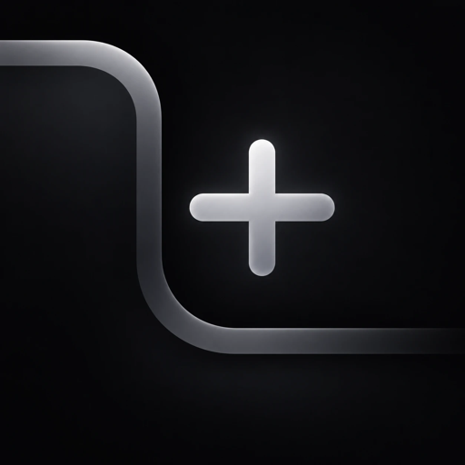

<h1 align="center">BetterTab</h1>

A calm, TV-style new tab page for Chrome: a big clock tucked behind the mountains, a dock of your own apps, and widgets that stay out of the way.

## Features
- **App bar:** add any site by link and its icon is found for you. Drag to reorder, Bar or Drawer style, separate apps per mode (Chill, Work and more).
- **Search:** one box for your apps and the web, with Google, Claude, ChatGPT, Perplexity and more.
- **Widgets:** To-do, World clock, App folder, Pinterest and more. Drag them anywhere or snap them to the edges; each has its own compact settings (gear or right-click).
- **Keep watching:** pick up where you left off on Prime Video, Netflix and JioHotstar.
- **3D wallpapers:** turn your own photo into a wallpaper with the clock behind the subject, processed on your computer.
- **Weather, night mode, 12/24-hour clock,** and everything stays in your browser.

## Install
1. Unzip this folder somewhere permanent (Chrome loads it from there).
2. Open chrome://extensions and turn on **Developer mode** (top right).
3. Click **Load unpacked** and pick the unzipped `better-tab` folder.
4. Open a new tab. If Chrome asks whether to keep the new tab page, choose **Keep it**.

## Use
- **+** adds an app: paste a link, the name and icon fill in automatically.
- Right-click an app to edit, refresh its icon, move it or remove it. Drag to reorder.
- Left/Right arrow keys move between apps, Enter opens.
- Moon button: night mode. Pills at top left: switch between Chill and Work mode (each has its own apps; right-click an app to move it to the other mode).
- Settings (gear): app bar style (Bar or Drawer), 24-hour clock. Turn on **Advanced settings** for the icons-in-bar slider, Brandfetch client ID, icon refresh and backup.
- Drawer mode: the bar shows your first apps; the **up arrow** after the last one expands the bar into a drawer with all apps (Esc or click outside to close, Up arrow key opens it).

## Icons
Order tried:
1. The App Store icon (matched by app name and developer)
2. The site's own app icon (PWA manifest / apple-touch-icon), ignored if the site redirects elsewhere (e.g. to a login page)
3. Brandfetch (only if you add a free client ID in Advanced settings)
4. A large site logo
5. Favicon, then a letter tile
Transparent or small icons are placed on a solid tile so everything looks like an app icon.

## Keep watching (Prime Video, Netflix, JioHotstar)
While you watch Prime Video in this Chrome browser, the extension notes the show,
episode, poster and how far in you are (from the video player itself), saved only
on this computer. The new tab then shows a "Keep watching" card above the app bar
with the time left. Click it to go back to the show (Prime resumes where you left
off); hover and press ✕ to dismiss. It hides once you're 95% through or after 3 weeks.
Turn it off in Settings → Keep watching; turning it off also deletes what was saved.
Only viewing in this browser is tracked, not the TV or phone apps.
